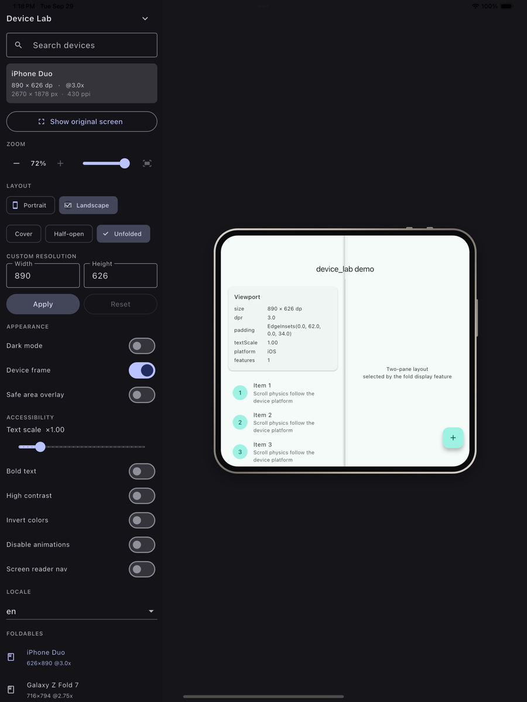
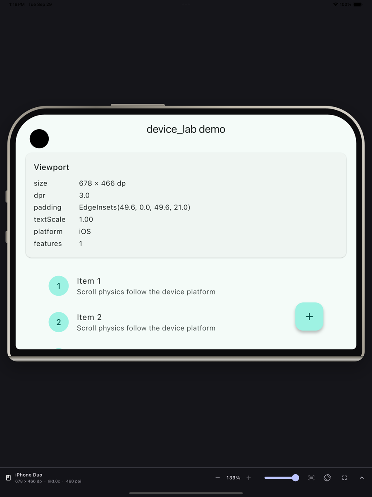
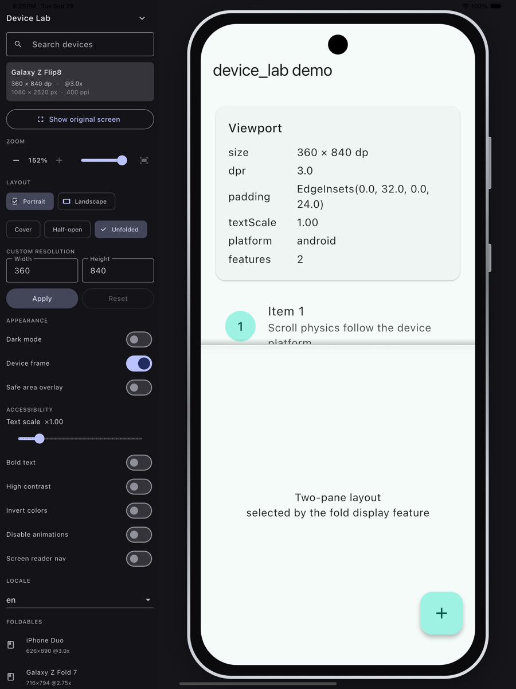
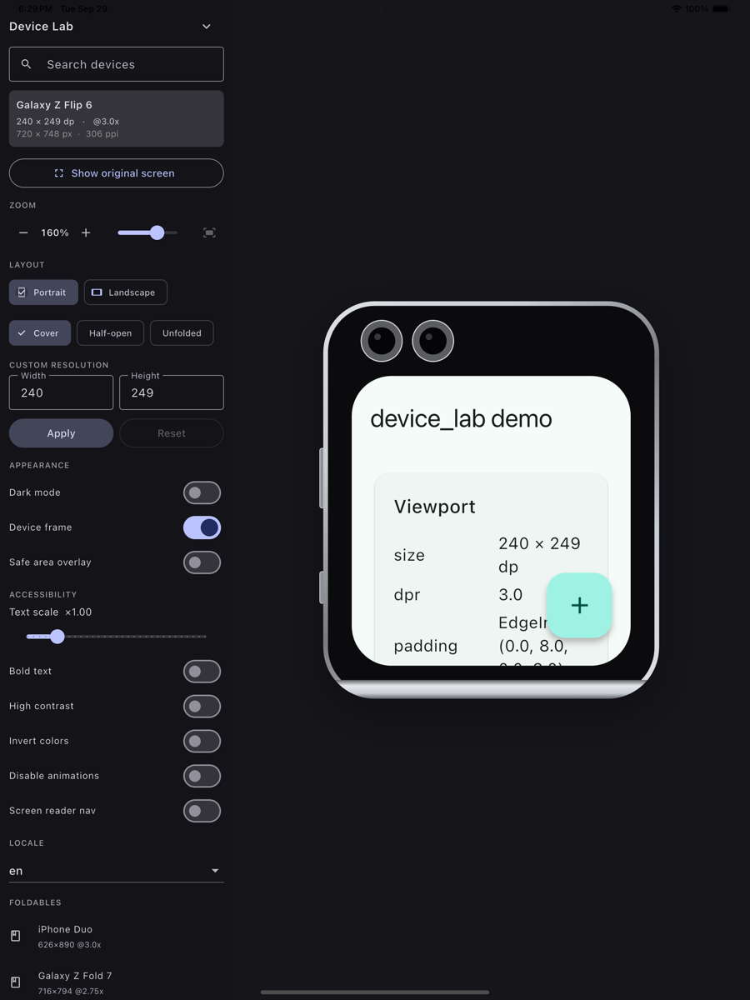
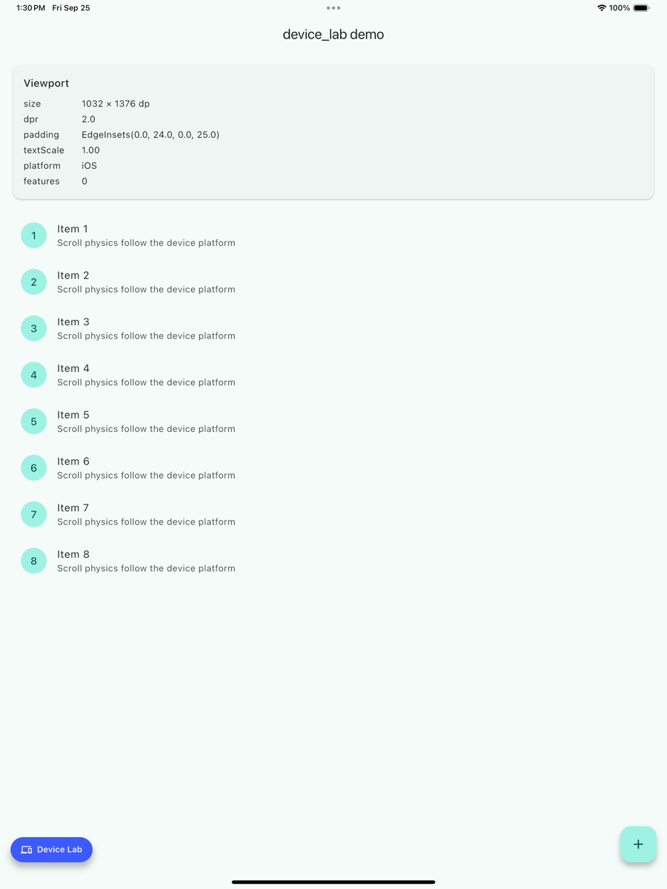

# device_lab

Preview a Flutter app on any device without booting a simulator.

> **This fork** ([AnasQasem/device_lab](https://github.com/AnasQasem/device_lab)) adds, on top of
> upstream `master`: a tools panel with pinned quick controls, Devices / Display tabs and category chips;
> debug VM service extensions (`ext.deviceLab.*`) that sweep a running app across every device of a
> category; a [device preview guide](doc/guide.md) including the `flutter_pixil_framework` wiring; and an
> agent skill ([`skills/device-lab`](skills/device-lab/SKILL.md)). Install the skill in Claude Code with
> `claude plugin marketplace add https://github.com/AnasQasem/device_lab.git` and
> `claude plugin install device-lab@device-lab`.

`device_lab` wraps your app, overrides `MediaQuery`, and renders it inside a
device frame with a tools panel for size, orientation, fold posture, locale,
text scale and accessibility flags.

<p align="center">
  
  
</p>

150 built-in devices across 17 vendors — iPhone (including **iPhone Duo**, the
foldable), Pixel, Galaxy S/A, book-folds, flip phones, iPads, Android tablets,
laptops, watches, TV, plus generic resolution presets from 320×568 to 4K. And
any size at all via free-form mode.

```dart
void main() {
  runApp(
    DeviceLab(
      builder: (_) => const MyApp(),
    ),
  );
}

class MyApp extends StatelessWidget {
  @override
  Widget build(BuildContext context) => MaterialApp(
        builder: DeviceLab.appBuilder,
        locale: DeviceLab.localeOf(context),
        home: const HomePage(),
      );
}
```

Two lines matter: `DeviceLab` at the root, and `builder: DeviceLab.appBuilder`
inside your `MaterialApp` so the simulated `MediaQuery` lands *below* the app
and reaches every route.

## Why not device_preview

| | device_preview | device_lab |
|---|---|---|
| Display features (`fold`, `hinge`, `cutout`) | not simulated | injected into `MediaQuery` |
| Foldables | frame art only | per-posture screens, cover + main |
| New hardware | requires a package release | `DeviceCatalog.loadJson` at runtime |
| Arbitrary resolutions | fixed list | any width × height |
| `TargetPlatform` | manual | follows the selected device |
| Golden tests | separate setup | same specs via `pumpOnDevice` |

## Foldables and flip phones

Book-folds (Galaxy Z Fold, Pixel Pro Fold, iPhone Duo, OnePlus Open) fold on a
vertical hinge; flip phones (Z Flip, Motorola Razr) fold on a horizontal one.
Both are modelled the same way — two screens plus a `HingeSpec` — and the hinge
axis rotates with the device when you flip orientation.

Flip phones get the same treatment as the iPhone Duo. Body sizes, screen
resolutions and pixel densities come from Samsung's and Motorola's own spec
sheets, and every open body is checked against the screen-to-body ratio the
vendors publish. The cover screens are the real ones, from the Flip4's wide
strip to the Flip8's full-face display, with lenses set in the body where they
sit beside the screen and cut into the screen where they sit inside it.

<p align="center">
  
  
</p>

The iPhone Duo is drawn from Apple's published body and display dimensions:
titanium rim, a square spine side against a round outer side, a round camera on
the cover, the buttons where Apple shows them, and no cutout on the open
display, which hides its camera under the panel. Its pixel resolutions and
densities come from Apple's spec sheet. Point sizes are not published, so they
are derived at 3x, which happens to give identical bezels on both axes.

The iPhone Duo's inner display is **landscape-natural** (its open body is
164.6mm wide by 117.8mm tall), so selecting it opens it in landscape with the
Dynamic Island along the top edge. `naturalOrientation` on `DeviceScreen`
carries that, and `safeArea` / `safeAreaRotated` are relative to it rather than
assuming portrait.

## Postures

Selecting a foldable exposes cover / half-open / unfolded postures. Each
posture resolves to a different screen and a different `DisplayFeature`, so
layout code written against the real API just works:

```dart
final fold = MediaQuery.of(context).separatingFold;
return fold == null
    ? const SinglePane()
    : const Row(children: [Expanded(child: List()), Expanded(child: Detail())]);
```

`FoldQuery` adds `hinges`, `cutouts`, `separatingFold`, `hasFold`,
`isBookPosture` and `isTabletopPosture` to `MediaQueryData`.

## Adding a device

The catalog is data, not code. Ship a JSON file and register it at startup:

```json
{"devices": [{
  "id": "acme.phone-x", "name": "Acme Phone X",
  "platform": "android", "category": "phone",
  "screens": [{
    "label": "Main",
    "logicalSize": {"w": 420, "h": 960},
    "pixelRatio": 3.0,
    "safeArea": {"t": 54, "b": 24},
    "cutouts": [{"shape": "punchHole", "size": {"w": 26, "h": 26}, "dy": 14}]
  }]
}]}
```

```dart
DeviceCatalog.loadJson(await rootBundle.loadString('assets/devices.json'));
```

Or register in Dart with `DeviceCatalog.register(DeviceSpec(...))`. Query with
`DeviceCatalog.query(category: DeviceCategory.foldable, releasedAfter: 2024)`.

## Golden tests

```dart
import 'package:device_lab/device_lab_testing.dart';

testWidgets('home renders on current phones', (tester) async {
  for (final device in DeviceCatalog.query(
    category: DeviceCategory.phone,
    releasedAfter: 2024,
  )) {
    await tester.pumpOnDevice(const MyApp(), device);
    await expectLater(
      find.byType(MyApp),
      matchesGoldenFile(goldenNameFor(device, scenario: 'home')),
    );
  }
});
```

## Device specs

Apple entries are derived from Apple's published technical specifications
(pixel resolution ÷ scale factor). Android entries are best-known logical sizes
and are approximations, as are all safe-area insets — good enough for layout
work, and correctable without touching package code. If a value is wrong for
hardware you own, open an issue with the output of `MediaQuery.of(context)`
from that device and it becomes a one-line data fix.

## Your app stays the root

The lab wraps your app in a stage, not in another app. Nothing it owns sits
between your app and its `Navigator`, `Overlay` or provider scope, so
`rootNavigator: true`, `showDialog`, `Get.bottomSheet`, pickers and any
`InheritedWidget` or `ProviderScope` you place inside `DeviceLab.builder` all
behave as they do without it, and dialogs open inside the device screen. The
app is laid out at the exact simulated size and then scaled to fit, so a
device larger than the window does not change its layout.

## The tools panel

The top of the panel stays put: the current device, Portrait / Landscape, the
fold postures of a foldable and **Show original screen**. Below it, the
**Devices** tab lists the catalog (search and the category chips, such as
Tablets then iPad or Android tablet, filter it) and the **Display** tab
holds zoom, custom resolution, appearance, accessibility and locale. Switching
devices and then rotating or folding the new one needs no scrolling.

## Rotating and zooming

Rotate turns the whole device, not just the screen. The camera cutout, side
buttons, spine and corner rounding all move with the body, and the app is
re-laid out at the turned size with its landscape insets. Cutouts are reported
through `MediaQuery.displayFeatures` in every orientation, at wherever the turn
carries them.

The bar and the panel share a zoom control: step down or up through presets,
drag the slider, or press fit to size the device to the space available. The
percentage is the scale the stage is actually drawing at, and a zoom larger
than the space allows is drawn at the largest that fits. The choice is
remembered with the rest of the selection.

## Hiding the lab

Three levels, smallest to largest:

| Control | Effect |
|---|---|
| Collapse the panel | device frame stays, a compact bar keeps the device and resolution visible |
| **Show original screen** | app fills the window, no frame, no `MediaQuery` override |
| `enabled: false` | lab is inert, zero overhead |

"Show original screen" is the runtime toggle. Reach it from the button in the
tools panel, with **Ctrl/Cmd + Shift + D**, or from your own code:

```dart
DeviceLab.togglePreview(context);
DeviceLab.setPreviewing(context, false);
DeviceLab.isPreviewing(context);
```

<p align="center">
  
</p>

While hidden, a **Device Lab** pill floats over the app to bring it back. It
docks to a corner like the Flutter Inspector button: drag it and it snaps to
whichever corner you release it nearest, so it never sits permanently on top of
your FAB or nav bar.

```dart
DeviceLab(
  restoreButtonAlignment: Alignment.bottomLeft,
  showRestoreButton: true,
  builder: (_) => const MyApp(),
)
```

The corner lives on the controller (`restoreAlignment` /
`setRestoreAlignment`), so a corner you drag it to survives hiding and showing
the lab again. `showRestoreButton: false` suppresses the pill entirely if you
would rather drive the toggle from your own debug menu.

Your app keeps its state across the toggle: the widget subtree is held behind a
`GlobalKey` and reparented rather than rebuilt, so scroll positions, form input
and navigation stack all survive.

`controller.active` is `enabled && previewing` — that is what `appBuilder`
checks, so when hidden your app sees the real window `MediaQuery` and its real
`TargetPlatform`.

## Remembering your selection

The device you pick sticks. `initialDeviceId` is only a **seed** — the device
to start on when nothing has been remembered yet. Once you pick something
else, that wins, and hiding the preview or rebuilding the widget no longer
snaps back.

By default this lasts for the lifetime of the process
(`SessionDeviceLabStorage`). To keep it across restarts, implement
`DeviceLabStorage` over whatever you already use:

```dart
class PrefsStorage extends DeviceLabStorage {
  const PrefsStorage(this.prefs);
  final SharedPreferences prefs;

  @override
  String? read(String key) => prefs.getString(key);

  @override
  void write(String key, String value) => prefs.setString(key, value);
}

DeviceLab(
  storage: PrefsStorage(prefs),
  builder: (_) => const MyApp(),
)
```

Reads and writes are synchronous, so load your store before `runApp`. Pass
`storage: null` to forget the selection on every rebuild.

## Automation: service extensions

For coding agents and CI: while a debug (or profile) app is running with an
enabled `DeviceLab`, you can sweep it across a whole device category over the
VM service or from DevTools, and get back layout errors and screenshots. The
package registers the extensions itself, so the app needs no wiring. They act on
the most recently mounted enabled `DeviceLab`, and do not exist in release
builds. With no `DeviceLab` mounted they return an extension error.

Call them as `ext.deviceLab.<name>`, with string parameters. Every response is
JSON. Bad parameters return the VM service's invalid-params error.

`ext.deviceLab.devices` lists the catalog. All parameters are optional.

| Param | Meaning |
| --- | --- |
| `category` | A `DeviceCategory` name: `phone`, `foldable`, `tablet`, `desktop`, `watch`, `tv` |
| `platform` | A `TargetPlatform` name, e.g. `iOS`, `android` |
| `ids` | Comma-separated device ids. Overrides the filters |

```json
{"count": 1, "devices": [{"id": "apple.iphone-17-pro", "name": "iPhone 17 Pro",
  "category": "phone", "platform": "iOS", "size": [402, 874],
  "rotatable": true, "foldable": false}]}
```

`ext.deviceLab.sweep` applies each device, orientation and posture in turn,
waits for the app to settle and records what went wrong. It takes the same
selectors as `devices`, plus:

| Param | Meaning |
| --- | --- |
| `offset`, `limit` | Batch the device list |
| `orientations` | `both` (default, only for devices that can rotate) or `natural` |
| `postures` | Foldables only: `all` (default, folded and flat), `every` (folded, halfOpened, flat) or `open` |
| `settleMs` | Wait before the next frame is awaited. Default `600` |
| `screenshots` | `none` (default), `failures` or `all` |
| `pixelRatio` | Screenshot scale. Default `0.5` |

```json
{"count": 2, "failed": 1, "results": [
  {"id": "apple.iphone-17-pro", "name": "iPhone 17 Pro",
   "orientation": "portrait", "posture": null, "size": [402, 874],
   "errors": ["A RenderFlex overflowed by 98 pixels on the right. (file:///app/lib/home.dart:42:9)"],
   "screenshot": "<base64 PNG>"}]}
```

Errors are collected from `FlutterError.onError` (the previous handler is still
called) and de-duplicated per case. Each is the error's summary plus the widget
location Flutter blames. Errors from the lab's own panel are prefixed
`[device_lab] ` and do not count towards `failed`; `screenshot` is present only
when requested. The previewed device, orientation, posture and preview state are
restored afterwards, and the preview is switched on for the sweep if it was
hidden. A second sweep while one is running returns "sweep already running".

`ext.deviceLab.show` applies one case and keeps it. It takes `id` (required),
`orientation` (`portrait` or `landscape`) and `posture` (a `FoldPosture` name),
shows the preview if hidden, waits like the sweep and returns the case record
without a screenshot.

`ext.deviceLab.capture` returns `{id, orientation, posture, size, screenshot}`
for the current state. It takes `pixelRatio` (default `0.5`). The PNG is the
simulated screen only, with no frame and no panel, and works while the preview
is hidden.

## Disabling in release

`enabled` defaults to `!kReleaseMode`, so the preview never ships to
production and you do not have to remember to turn it off. When disabled,
`DeviceLab` returns your app untouched and `appBuilder` is a pass-through, so
there is no release-mode overhead.

Pass `enabled: false` to turn it off in debug too, or your own flag to gate it
behind a developer menu.
